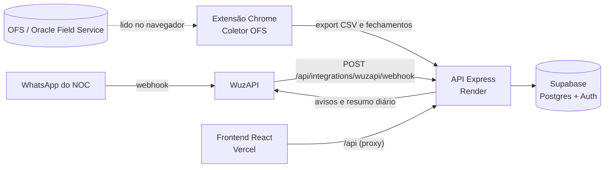

<div align="center">

# JH RedeFlow · Rede O&M

**Plataforma de operação e manutenção da rede de fibra: chamados, equipes de campo, prazos e indicadores num só lugar.**


[Funcionalidades](#-funcionalidades) ·
[Arquitetura](#-arquitetura) ·
[Rodar localmente](#-rodar-localmente) ·
[Configuração](#-configuração) ·
[Deploy](#-deploy) ·
[Integrações](#-integrações) ·
[Desenvolvimento](#-desenvolvimento)

</div>

---

## 📋 Sobre

O **JH RedeFlow** acompanha a operação da rede do começo ao fim:

1. O acionamento chega pelo WhatsApp do NOC.
2. Vira chamado, é distribuído a um técnico e acompanhado em campo.
3. É fechado e entra nos indicadores (IGP, SLA, prazos).

O sistema cruza essas informações com o OFS e avisa a equipe quando um prazo está para estourar.

É um sistema **interno**: só entra quem tem conta criada pela empresa, e cada cargo vê apenas o que suas permissões liberam.

## ✨ Funcionalidades

<table>
<tr>
<td width="50%" valign="top">

**🛠️ Operação**
- Fila de chamados com 100 por página, filtros, atalhos de teclado e exportação para Excel
- Acionamentos do NOC lidos do WhatsApp: aceitar, recusar e consolidar
- Detalhe do chamado com linha do tempo, observações com fotos, menções e histórico
- Finalização com checklist por tipo de chamado
- Mapa da fila por região e bairro; incidentes em massa por OLT
- **Meus chamados**: tela de celular para o técnico em campo

</td>
<td width="50%" valign="top">

**📊 Indicadores**
- Visão geral em tempo real, com meta mensal
- IGP (Acesso e Backbone), Análise de prazo e mapa de calor
- Relatórios:
  - fora do prazo e produtividade;
  - motivos, gargalos e reincidência;
  - comparação entre períodos
- Relatório mensal em PDF e **Modo TV** para telão
- Painel diário a partir da exportação do OFS

</td>
</tr>
<tr>
<td valign="top">

**👥 Equipes**
- Técnicos e auxiliares, supervisores e carga de trabalho
- Sugestão de técnico e risco de estourar o prazo
- Aba Pessoas, com perfil, status, foto e banner (inclusive GIF)

</td>
<td valign="top">

**⚙️ Administração e alertas**
- Usuários, cargos e permissões por tela
- Importações (D-0, histórico, Drive) e saúde da integração OFS
- Avisos de prazo e escalonamento automático no sino e no WhatsApp
- Histórico de alterações com filtros e exportação
- LGPD: política de privacidade, termos de uso e "Baixar meus dados"

</td>
</tr>
</table>

Também tem tema claro e escuro, sete temas de cor e navegação por teclado. Os painéis guardam o último resultado e só baixam de novo quando algo muda: o servidor responde 304 quando nada mudou.

## 🧭 Arquitetura



| Parte | Pasta | Onde roda |
|---|---|---|
| Frontend (React 19 + Vite) | [`frontend/`](frontend) | Vercel |
| API (Express 5 + TypeScript) | [`backend/`](backend) | Render |
| Banco, autenticação e arquivos | [`supabase/migrations/`](supabase/migrations) | Supabase |
| Extensão do Chrome (Coletor OFS, v1.3.4) | [`extensao-rede/`](extensao-rede) | Chrome do operador |

## 🚀 Rodar localmente

**Pré-requisitos:** Node.js 20 ou mais novo (testado no 24) e npm.

```bash
npm install
```

### Preview com dados de demonstração (recomendado)

Sobe API e telas com dados fictícios em memória. Nada vai para produção.

```bash
npm run preview
```

- Telas: http://localhost:8000
- API: http://localhost:3333
- Login de demonstração: `admin@jhtelecom.com` / `RedeFlow@2026`. Esse usuário só existe nos dados fictícios locais.

No Windows, o atalho [`Abrir preview.bat`](Abrir%20preview.bat) faz o mesmo. As telas atualizam sozinhas a cada arquivo salvo.

### Desenvolvimento ligado ao Supabase

```bash
cp backend/.env.example backend/.env   # depois preencha com as variáveis abaixo
npm run dev
```

- Telas: http://localhost:5173
- API: http://localhost:3333
- Conferir a conexão com o banco: http://localhost:3333/health/supabase

> [!NOTE]
> Sem `SUPABASE_URL`, `SUPABASE_ANON_KEY` e `SUPABASE_SERVICE_ROLE_KEY`, a API roda **em memória** e perde os dados ao reiniciar. Os dados fictícios só entram com `REDEFLOW_DEMO_DATA=true`.

## 🔧 Configuração

As variáveis da API ficam em `backend/.env` (local) ou no painel do Render (produção). **Nunca** envie `.env` nem segredos para o repositório.

<details>
<summary><strong>Variáveis da API (backend)</strong></summary>

| Variável | Obrigatória | Para que serve |
|---|---|---|
| `SUPABASE_URL` | produção | URL do projeto Supabase |
| `SUPABASE_ANON_KEY` | produção | Chave pública do Supabase |
| `SUPABASE_SERVICE_ROLE_KEY` | produção | Chave de serviço (só no servidor) |
| `JWT_SECRET` | sim | Assina as sessões (o Render gera sozinho) |
| `CORS_ORIGINS` | não | Origens liberadas, separadas por vírgula (padrão: `https://jh-rede.vercel.app`) |
| `APP_PUBLIC_URL` | não | Endereço do site usado nos links dos avisos (padrão: `https://jh-rede.vercel.app`) |
| `REDEFLOW_RUNTIME` | não | `supabase` em produção |
| `REDEFLOW_DEMO_DATA` | não | `true` carrega os dados fictícios em memória |
| `WUZAPI_WEBHOOK_TOKEN` | p/ WhatsApp | Token que o webhook da WuzAPI precisa enviar |
| `WUZAPI_ACTIVATION_GROUP_ID` | p/ WhatsApp | Grupo(s) dos acionamentos, separados por vírgula |
| `WUZAPI_API_URL` | p/ avisos | Endereço da WuzAPI para enviar mensagens |
| `WUZAPI_USER_TOKEN` | p/ avisos | Token do usuário da WuzAPI |
| `WUZAPI_ALERT_CHAT` | p/ avisos | Grupo que recebe avisos de prazo e escalonamento |
| `WUZAPI_REPORT_CHAT` | não | Grupo do resumo diário das 07:00 |
| `WUZAPI_DEBUG` / `WUZAPI_SKIP_GROUP_FILTER` | não | Diagnóstico do webhook |
| `OFS_INGEST_TOKEN` | p/ extensão | Token aceito nos envios do Coletor OFS |
| `GEMINI_API_KEY` / `GEMINI_MODEL` | não | Leitura assistida de cards fora do padrão |
| `PORT` | não | Porta da API (o Render injeta sozinho) |

</details>

<details>
<summary><strong>Variáveis do site (frontend)</strong></summary>

| Variável | Para que serve |
|---|---|
| `VITE_API_URL` | Endereço da API. Em produção fica vazio: a Vercel repassa `/api/*` ao Render (veja [`vercel.json`](vercel.json)). |

</details>

## ☁️ Deploy

Os deploys partem da branch `main`.

**API (Render).** O [`render.yaml`](render.yaml) cria o serviço. Para criar, use **New > Blueprint** e escolha este repositório. Ou crie um Web Service com:

```text
Build Command:     npm install --include=dev && npm run build --workspace backend
Start Command:     node backend/dist/server.js
Health Check Path: /health
```

Cadastre no Render as variáveis marcadas como `sync: false` e confira o `https://SEU-SERVICO.onrender.com/health`.

**Site (Vercel).** Publica sozinho a cada push. O [`vercel.json`](vercel.json) repassa `/api/*` para a API e manda as outras rotas para o `index.html` (SPA).

**Banco (Supabase).** As mudanças de estrutura ficam em [`supabase/migrations/`](supabase/migrations), em ordem de data. Para o primeiro acesso, siga o [guia do Supabase](docs/supabase-setup.md):
- crie o usuário em **Authentication > Users**;
- ligue esse usuário a um perfil em `public.profiles`.

## 🔌 Integrações

| Integração | Como funciona | Documentação |
|---|---|---|
| **WhatsApp (WuzAPI)** | Recebe os cards de acionamento do NOC e envia avisos de prazo, escalonamento e resumo diário | [docs/wuzapi-webhook.md](docs/wuzapi-webhook.md) · [VM da WuzAPI](docs/oracle-vm-deploy.md) |
| **OFS (Coletor OFS)** | A extensão exporta as atividades do OFS e lê os fechamentos, sem alterar nada no OFS. Atualiza o status OFS, o endereço, a Data Fim e o Painel diário | [extensao-rede/README.md](extensao-rede/README.md) |
| **Google Drive / Apps Script** | Base histórica e mapeamento dos campos oficiais | [docs/appscript-integration-map.md](docs/appscript-integration-map.md) · [docs/official-data-mapping.md](docs/official-data-mapping.md) |

## 🧑‍💻 Desenvolvimento

### Comandos

| Comando | O que faz |
|---|---|
| `npm run preview` | API e telas com dados fictícios (porta 8000) |
| `npm run dev` | API e telas no modo de desenvolvimento |
| `npm run build` | Build do site e checagem de tipos da API |
| `npm run typecheck` | Checagem de tipos das duas partes |
| `npm test --workspace backend` | Testes da API (unitários e HTTP) |
| `npm run theme:dark --workspace frontend` | Gera as versões escuras dos temas a partir do CSS claro |
| `node frontend/scripts/generate-licenses.mjs` | Atualiza a lista de licenças de terceiros (página `/licencas`) |

### Estrutura

```text
.
├── backend/              API Express
│   ├── src/
│   │   ├── server.ts     rotas, autenticação e rotinas de fundo
│   │   ├── store/        acesso a dados (Supabase ou memória)
│   │   ├── integrations/ Supabase, WuzAPI e OFS
│   │   ├── imports/      leitura de planilhas e da base D-0
│   │   └── read-cache.ts cache dos painéis (vale até algum dado mudar)
│   └── test/             testes unitários e HTTP
├── frontend/             site React
│   ├── src/pages/        uma tela por arquivo
│   ├── src/components/   peças reaproveitadas (Pager, Shell, gráficos...)
│   ├── src/lib/          cache, temas, dados da empresa, licenças
│   └── scripts/          tema escuro, contraste e licenças
├── extensao-rede/        extensão do Chrome (Coletor OFS)
├── supabase/migrations/  estrutura do banco
├── docs/                 guias das integrações
└── ROADMAP.md            histórico de tudo o que foi implementado
```

### Combinados do projeto

- **Roadmap:** toda implementação entra no [`ROADMAP.md`](ROADMAP.md).
- **Listas:** no máximo **100 por página**, com o componente `Pager`. Listas grandes paginam no servidor.
- **Contraste:** textos com pelo menos **4,5:1** no tema claro e no escuro. Confira com `frontend/scripts/contrast-audit.js`.
- **Revisão antes de subir:** cada mudança é conferida no `npm run preview` antes do push.
- **Banco:** migrations, mudanças de dados em produção e variáveis de ambiente só com autorização.

## 📄 Licença

© 2026 Matheus Terra Farias. Todos os direitos reservados.

Software **proprietário**. Copiar, modificar ou distribuir, no todo ou em parte, só com autorização por escrito (veja [`LICENSE`](LICENSE)). A marca e a logo JH Telecom pertencem aos seus titulares. As bibliotecas de código aberto usadas estão listadas, com as licenças, na página `/licencas` do sistema.

Contato: [planilhasjh@gmail.com](mailto:planilhasjh@gmail.com)
